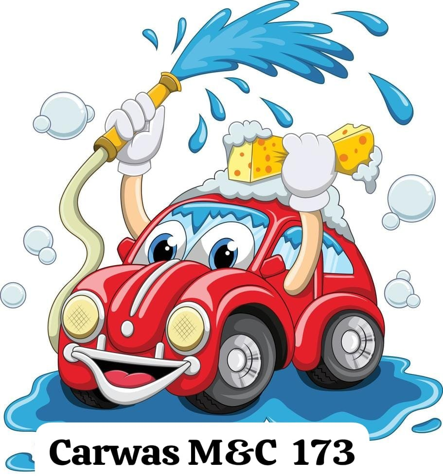

# 🚗 Carwas M&C 173 — Spa Móvil de Autos

> Servicio profesional de lavado y detallado de autos **a domicilio** en Cartago, Costa Rica.

[](https://TU-USUARIO.github.io/carwas-mc/)
[](https://wa.me/50687375227)
[](https://TU-BLOG.blogspot.com)

---

## 📸 Vista Previa



**Landing page:** `https://TU-USUARIO.github.io/carwas-mc/`

---

## 📁 Estructura del Proyecto

```
carwas-mc/
├── index.html              # Landing page principal
├── README.md               # Este archivo
├── css/
│   └── styles.css          # Estilos completos (2000+ líneas)
├── js/
│   └── main.js             # Lógica: nav, precios, WhatsApp, galería
├── img/
│   ├── logo.png            # Logo Carwas M&C 173
│   ├── galeria1.jpg        # Fotos del servicio (1–10)
│   └── ...
└── blogger/
    ├── pagina_blogger.html      # Versión para pegar en Blogger
    └── blogger_theme_inject.xml # Inyección de CSS/JS en tema Blogger
```

---

## 🚀 Despliegue

### GitHub Pages (landing page)

1. Fork o clonar este repositorio
2. Ir a **Settings → Pages → Deploy from branch `main`**
3. URL pública: `https://TU-USUARIO.github.io/carwas-mc/`

### Blogger

1. Copiar contenido de `blogger/pagina_blogger.html`
2. Reemplazar `TU-USUARIO` con tu usuario de GitHub
3. En Blogger → **Páginas → Nueva página → Modo HTML** → Pegar → Publicar

Ver [`GUIA_DESPLIEGUE.md`](GUIA_DESPLIEGUE.md) para instrucciones detalladas paso a paso.

---

## 🛠️ Stack Técnico

| Tecnología | Uso |
|-----------|-----|
| HTML5 semántico | Estructura de la página |
| CSS3 (Variables, Grid, Flexbox, Animations) | Diseño y layout |
| JavaScript Vanilla (ES6+) | Interactividad |
| Google Fonts (Bebas Neue + DM Sans) | Tipografía |
| GitHub Pages | Hosting de assets (CSS, JS, imágenes) |
| Blogger | CMS para publicación |
| WhatsApp API | Canal de reservas |

### Sin dependencias externas de JS
El proyecto no usa jQuery, React ni ningún framework. Carga rápido en móviles con conexión lenta.

---

## ⚙️ Funcionalidades

- ✅ **Navbar fija** con scroll + hamburger para móvil
- ✅ **Hero animado** con logo flotante
- ✅ **Calculadora de precios** automática según vehículo y servicio
- ✅ **Formulario → WhatsApp** con mensaje prellenado
- ✅ **Galería con lightbox** (10 fotos, diseño mosaico)
- ✅ **Scroll fade-in** en todos los elementos
- ✅ **Botón flotante WhatsApp** con animación pulse
- ✅ **Totalmente responsive** (móvil, tablet, desktop)
- ✅ **Sin QR de pago** (eliminado por solicitud)

---

## 📞 Contacto del Negocio

| Canal | Dato |
|-------|------|
| 📱 WhatsApp | [8737-5227](https://wa.me/50687375227) |
| 💳 SINPE Móvil | 6094-5354 |
| 📍 Dirección base | Casa 173, Res. Doña Flora, Cartago |
| ⏰ Horario | Lun–Mar y Jue–Dom, 6am–5pm |

---

## 🗺️ Zonas de Cobertura

Cartago Centro · Paraíso · Orosí · Cervantes · Dulce Nombre · Aguacaliente

---

## 💲 Precios

| Servicio | Automóvil | SUV/4x4 | Duración |
|---------|-----------|---------|----------|
| Lavado básico + aspirado | ₡5,000 | ₡7,000 | 1–1.5 hrs |
| Lavado + encerado | ₡7,000 | ₡10,000 | 2 hrs |
| Detallado completo | ₡25,000 | ₡25,000 | 3–4 hrs |

---

## 📝 Cómo actualizar las fotos

1. Ir a la carpeta `img/` en el repositorio
2. Click en la foto → ícono editar → "Replace file"
3. Subir la nueva foto con el **mismo nombre**
4. GitHub Pages se actualiza automáticamente en ~2 minutos

---

*Desarrollado para Carwas M&C 173 · Cartago, Costa Rica · 2025*
